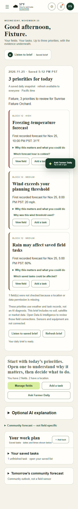

# Farmer Daily


**AI for every farmer.** Farmer Daily helps Washington growers organize fields, review public agricultural data, and understand a short, source-backed daily brief.

Created by **Radhika Chandra**. Product direction, requirements and repeated manual testing were led by Radhika; implementation, fixes and automated tests were developed with substantial assistance from OpenAI Codex.

[Open the deployed app](https://calm-desert-02e51f41e.1.azurestaticapps.net) · [Setup guide](docs/SETUP.md) · [MIT license](LICENSE)

The deployed app requires Microsoft sign-in to protect each grower's records. Do not enter a real farm's information merely to review the project; use a fictional sample and leave optional paid or messaging integrations off.

<details>
<summary>View the app: three priorities for a sample orchard</summary>



*Actual application UI from an isolated browser integration test. The farm and forecast inputs are fictional; this screenshot is not evidence of current weather or a live AI response.*

</details>

## What the application does

- Draw and save field boundaries, crops, preferences and tasks.
- Retrieve NOAA/NWS weather, USGS elevation, farm context, and dated Sentinel-2 / NASA-USGS Landsat vegetation measurements, subject to source permissions and availability.
- Build a three-priority brief with source references and bounded decision rules.
- Optionally use language models for permitted read-only tool selection, personalization and comparisons; route lighter summaries to a lower-cost model.
- Offer themes, reading support and free device-voice controls.
- Provide consent-based messaging/calendar integrations and administrator-approved operational workflows, requiring separate provider setup.

Satellite measurements are not disease diagnoses. No agency endorsement, guaranteed agronomic accuracy or measured cost saving is claimed. Government-funded daily briefs and optional specialist/startup recommendations are the **policy vision**, not an existing public program or connected marketplace.

## Run and check the source

Use Node.js 22 or newer:

```sh
npm ci
npm --prefix api ci
npm run build
npm run check
npm test
npm start
```

Open `http://localhost:4173`. **This command serves a limited interface preview, not the full cloud application.** The account gate is expected: local `npm start` does not emulate Microsoft sign-in or private farm APIs, and its sign-in link opens the deployed app. For a no-credential, automated walkthrough of working fields and briefs, run the isolated browser test:

```sh
node tests/phase-one-browser-smoke.cjs
```

It uses the actual UI and advisory engine with fictional farms and simulated provider data, blocks external HTTPS, and prints a report and screenshot paths. Chrome is required; see [setup](docs/SETUP.md) for its path and cloud prerequisites. Neither these tests nor `npm start` enables paid AI or sends SMS/WhatsApp messages.

## Try the core workflow

In the deployed app, sign in, create a fictional farm, add a field using the map, choose a crop, and save. Review the field's weather and source timestamps, add a task, and build the daily brief. Check the evidence and missing-data notices before acting. Settings includes themes, reading support and device-voice preferences. Optional AI, calendars and phone delivery have separate consent and provider requirements; they are not necessary to review the base workflow.

## Technologies

JavaScript, HTML/CSS, Node.js, Azure Static Web Apps / Functions, Cosmos DB, Leaflet, OpenAI, and public agricultural data adapters. See [requirements](docs/PRD.md) and [third-party notices](THIRD_PARTY_NOTICES.md).

## Validation

See [validation results and limitations](docs/VALIDATION.md). Tests use synthetic data and mocked providers; passing them does not prove production delivery, subjective voice quality or agronomic accuracy.

## About this submission copy

This source snapshot is based on application **0.18.2**, including faster bounded brief preparation and greetings that follow the Washington farm clock. It excludes private Git history, personal administrator addresses, credentials, farm records, operational notes, recordings and generated presentation artifacts. Administrator identities are configured server-side and default to none. AI requests, messaging and scheduling must remain disabled until deliberately configured and approved. The live app and its administrator settings have not been changed by preparing this copy.

This public repository begins with an honestly dated, sanitized source baseline; it does not recreate the original private development history. Future commits should describe genuine changes. Publication is not a claim of Hack Club certification.

## License

Original Farmer Daily application code is available under the [MIT license](LICENSE). Included third-party materials retain their own licenses and notices. The license does not grant access to hosted services, private data or provider accounts.
